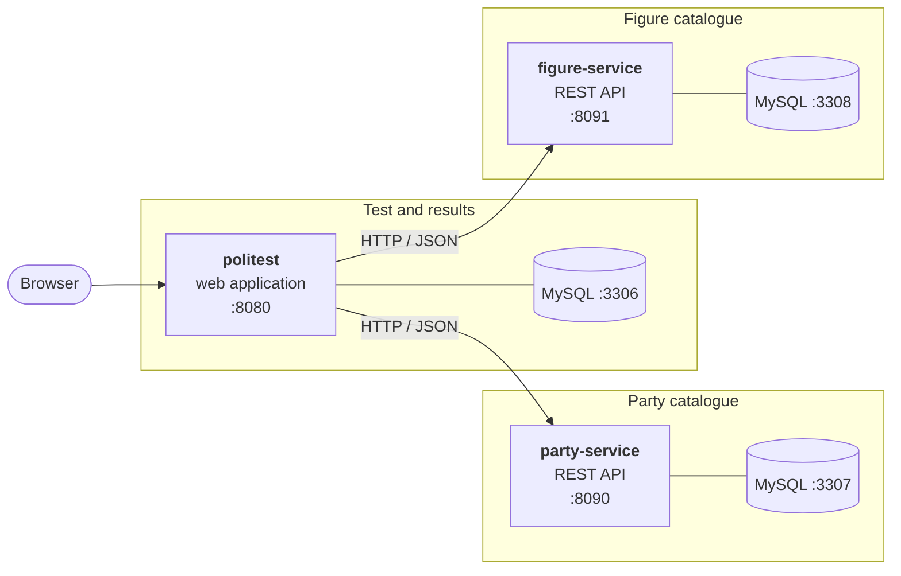
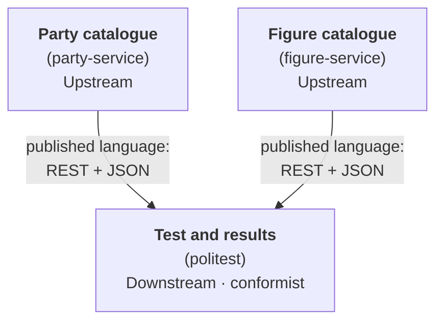
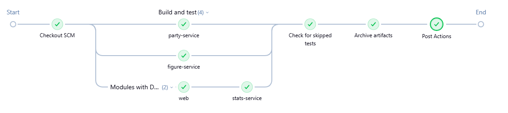

# Politest

A multilingual (Catalan, Spanish, English) political compass test. Users answer a short questionnaire and receive their position on eight political axes, together with an affinity score against political parties and historical or contemporary figures.

The project is built as a small system of three Spring Boot applications and is used as a practical exercise in clean architecture, domain-driven design and continuous integration.

> **Disclaimer.** The positions assigned to parties and figures are provisional, educational estimates. They are not authoritative statements about any organisation or person.

## System overview



| Service | Responsibility | App port | Database port | phpMyAdmin |
|---|---|---|---|---|
| [`politest`](politest) | Questionnaire, scoring, result pages, share links, legal pages. Server-side rendered with Thymeleaf. | 8080 | 3306 | 8081 |
| [`party-service`](party-service) | Party catalogue and affinity calculation against parties. | 8090 | 3307 | 8083 |
| [`figure-service`](figure-service/figure-service) | Figure catalogue (localised) and affinity calculation against figures. | 8091 | 3308 | 8084 |

Each service owns its database. No service reads another service's tables.

## Context map



| Context | Core concepts | Notes |
|---|---|---|
| Test and results | Question, answer, axis score, result, share link | Consumes the other two contexts through HTTP clients and does not model parties or figures itself. |
| Party catalogue | `Party`, `Position`, `AxisScores`, `AxisWeights`, `Affinity` | Aggregate root `Party`; domain service `AffinityCalculator`. |
| Figure catalogue | `Figure`, `Position`, `Language`, `Affinity` | Aggregate root `Figure`; texts are localised, so every query takes a `lang` parameter. |

The only shared contract between the contexts is deliberately small: the eight axis codes (`ECON`, `WELFARE`, `LIBERTY`, `CULTURE`, `NATION`, `ECOLOGY`, `DEMOCRACY`, `CHANGE`) and the 0–100 scale, where 0 is the left pole and 100 is the right pole. It is duplicated rather than shared as a library so that the services stay independently deployable.

### How affinity is computed

For the axes shared by the user and the target, affinity is `100 − weighted mean absolute distance`. Axis weights range from 0 to 10 and default to 1. A result of 100 means identical positions.

## Architecture

`party-service` and `figure-service` follow a hexagonal (ports and adapters) layout with tactical DDD patterns:

```
domain/         value objects, aggregate roots, domain service, domain exceptions
application/    inbound ports (use cases), outbound ports, application services
adapter/in/     REST controllers and API models
adapter/out/    JDBC persistence adapters
config/         composition root (the only place where Spring wires the layers)
```

The dependency rules are enforced automatically by [ArchUnit](https://www.archunit.org/) tests, so a violation fails the build. See each service's README for details.

The `politest` web application is organised as a modular monolith using Spring Modulith (`affinity`, `catalog`, `figures`, `quiz`, `result`, `scoring`).

## Documentation

| Document | Content |
|---|---|
| [`party-service/README.md`](party-service/README.md) | Hexagonal layout, DDD model, API reference, running locally |
| [`figure-service/figure-service/README.md`](figure-service/figure-service/README.md) | Same for the figure catalogue, including language handling |
| [`jenkins/README.md`](jenkins/README.md) | Jenkins setup in Docker, pipeline description, troubleshooting |

## Technology

Java 25 · Spring Boot 4.1 · Spring Modulith · Thymeleaf · Spring JDBC · Flyway · MySQL 8.4 · Maven · JUnit 5 · ArchUnit · Docker Compose · Jenkins

## Running locally

Prerequisites: JDK 25, Maven (or the included wrapper in `politest`), Docker.

Start each service's database, then the service itself. Start the two APIs first, since the web application calls them.

```bash
# party-service  (http://localhost:8090)
cd party-service
docker compose up -d
mvn spring-boot:run

# figure-service  (http://localhost:8091)
cd figure-service/figure-service
docker compose up -d
mvn spring-boot:run

# web application  (http://localhost:8080)
cd politest
docker compose up -d
./mvnw spring-boot:run
```

Flyway creates the schema and loads the seed data on first start. The service URLs the web application uses can be changed with `app.party-service.url` and `app.figure-service.url`.

The credentials in the compose files are development defaults for local use only.

## Tests and continuous integration

```bash
mvn verify        # inside any of the three modules
```

The suite covers domain rules, application services against in-memory ports, seed data consistency, the Spring wiring and the architecture rules.

A [`Jenkinsfile`](Jenkinsfile) at the repository root builds and tests the three modules in parallel inside a Maven container, archives the jars and publishes the JUnit reports. The Jenkins setup itself runs in Docker and is documented in [`jenkins/README.md`](jenkins/README.md).

<!-- Replace with a screenshot of a green pipeline run: -->
<!--  -->

## Roadmap

- Event-driven statistics with Kafka (`test.completed` event and a dedicated statistics service)
- Reliability patterns for messaging: retries, dead-letter topic, idempotent consumers, transactional outbox
- Integration tests with Testcontainers
