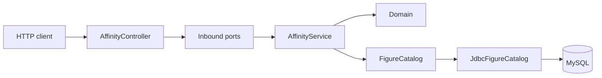

# figure-service

Spring Boot microservice that stores the ideological positions of deceased historical figures of the 20th century and
computes which of them is closest to a given person. It has its own MySQL database and exposes a REST API on port `8091`.

The positions are provisional estimates (confidence 1 to 3, with notes stored in the database) and do not represent an
official or academic assessment. Figures are included for educational comparison only.

## Architecture

The service follows a hexagonal (ports and adapters) architecture, the same design as `party-service`. The business logic
does not depend on Spring, JDBC or HTTP; technology is plugged in from the outside through ports.

```
com.politest.figure
├── domain                 Business rules, no framework dependencies
│   ├── model              Figure, Position, FigureWithPositions, DatasetInfo, Axes
│   └── AffinityCalculator
├── application            Use cases
│   ├── port.in            CompareAffinityUseCase, QueryFiguresUseCase
│   ├── port.out           FigureCatalog
│   └── service            AffinityService
├── adapter
│   ├── in.web             REST controller and API models
│   └── out.persistence    JdbcFigureCatalog (MySQL through JdbcClient)
└── config                 Composition root: wires services to ports
```



Dependencies always point inwards. `ArchitectureTests` enforces the rules with ArchUnit, so a violation breaks the build.
`AffinityServiceTests` runs the use cases against an in-memory implementation of the `FigureCatalog` port, without Spring
and without a database.

## Languages

Names and descriptions are stored per language (`es`, `ca`, `en`). Endpoints accept an optional `lang` query parameter
(default `es`). The affinity endpoint rejects unsupported languages with `400`.

## How affinity is computed

For each axis, the distance between the person and the figure (0 to 100) is measured. Affinity is 100 minus the weighted
mean distance. Axes where a figure has no position (because they were not an issue in their time) are ignored.
Scale: 0 is the left pole of an axis, 100 the right pole.

## Running locally

1. Start the database: `docker compose up -d` (MySQL on port 3308, phpMyAdmin on <http://localhost:8084>).
2. Run `FigureServiceApplication`. Flyway creates the schema and loads the data.
3. Try it:
   - <http://localhost:8091/api/v1/figures?lang=en>
   - <http://localhost:8091/actuator/health>
   - `POST http://localhost:8091/api/v1/affinity?lang=en` with
     `{"scores":{"ECON":78,"WELFARE":71,"LIBERTY":22,"CULTURE":48,"NATION":35,"ECOLOGY":10,"DEMOCRACY":55,"CHANGE":60}}`

## API

| Method | Path | Description |
|---|---|---|
| GET | `/api/v1/figures?lang=` | All active figures with their positions and dataset information |
| GET | `/api/v1/figures/{code}?lang=` | One figure, or 404 |
| POST | `/api/v1/affinity?lang=` | Affinity of the given scores (and optional weights) with every figure, sorted from highest |

Invalid requests (missing scores, unknown axis, values out of range, unsupported language) return `400` with
`{"error": "..."}`.

## Adding or correcting data

Never edit an applied migration. Add a new one in `src/main/resources/db/migration`: an `INSERT` into `figure`,
three rows in `figure_text` (one per language) and the rows of `figure_position`, or an `UPDATE` to correct values and,
when the dataset version changes, an `UPDATE` of `dataset_info`.

## Tests

```
mvn verify
```

| Test | Purpose |
|---|---|
| `AffinityCalculatorTests` | Domain calculation |
| `AffinityServiceTests` | Use cases against an in-memory catalogue |
| `ArchitectureTests` | Hexagonal dependency rules (ArchUnit) |
| `SeedDataTests` | Consistency of the seed migration |
