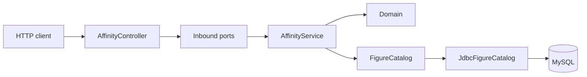

# figure-service

Spring Boot microservice that stores the ideological positions of deceased historical figures of the 20th century and
computes which of them is closest to a given person. It has its own MySQL database and exposes a REST API on port `8091`.

The positions are provisional estimates (confidence 1 to 3, with notes stored in the database) and do not represent an
official or academic assessment. Figures are included for educational comparison only.

## Architecture

The service follows a hexagonal (ports and adapters) architecture, the same design as `party-service`. The business logic
does not depend on Spring, JDBC or HTTP; technology is plugged in from the outside through ports.

```
com.politest.figure
├── domain                 Business rules, no framework dependencies
│   ├── model              Figure (aggregate), Position and the value objects
│   ├── error              DomainValidationException
│   └── AffinityCalculator  (domain service)
├── application            Use cases
│   ├── port.in            CompareAffinityUseCase, QueryFiguresUseCase
│   ├── port.out           FigureCatalog
│   └── service            AffinityService
├── adapter
│   ├── in.web             REST controller and API models
│   └── out.persistence    JdbcFigureCatalog (MySQL through JdbcClient)
└── config                 Composition root: wires services to ports
```



Dependencies always point inwards. `ArchitectureTests` enforces the rules with ArchUnit, so a violation breaks the build.
`AffinityServiceTests` runs the use cases against an in-memory implementation of the `FigureCatalog` port, without Spring
and without a database.

## Languages

Names and descriptions are stored per language (`es`, `ca`, `en`). Endpoints accept an optional `lang` query parameter
(default `es`). Every endpoint rejects unsupported languages with `400`.

## Domain model (DDD)

The domain is modelled with the vocabulary of the problem. Invalid states cannot be represented: every object validates
itself when it is created.

| Concept | Kind | Rules it enforces |
|---|---|---|
| `Figure` | Aggregate root | Code and name required; birth not after death; at most one position per axis; positions always in axis order and immutable from outside |
| `Position` | Entity-like value | Axis, percentage and confidence are mandatory |
| `AxisCode` | Value object (enum) | Exactly the eight axes; anything else is rejected |
| `Percentage` | Value object | 0 to 100, immutable; knows the distance to another percentage |
| `Confidence` | Value object (enum) | Weak, partial or solid (levels 1 to 3) |
| `FigureCode` | Value object | Upper-case letters, digits and underscores |
| `Language` | Value object (enum) | `es`, `ca` or `en` |
| `AxisScores`, `AxisWeights` | Value objects | A person's answers and the importance of each axis, validated on creation |
| `Affinity` | Value object | A result between 0 and 100 |
| `AffinityCalculator` | Domain service | The calculation, with no state and no framework |

Ubiquitous language: *figure*, *position*, *axis*, *percentage*, *confidence*, *affinity*, *dataset*, *language*. These names
are used in the code, the tests and the API.

The REST layer works with plain numbers and strings; they are converted into domain objects at the edge of the use case,
and any violation surfaces as a `DomainValidationException`, which the web adapter turns into a `400` response.

### Bounded context

This service owns everything about historical figures and how close a person is to them. It does not know about parties,
quizzes or users. The only thing shared with the other services is the contract of the eight axis codes and the 0 to 100
scale, which is deliberately duplicated rather than shared as a library, so each service can be deployed on its own.
`party-service` models a similar concept (positions and affinity) with a different aggregate: that is the point of having
separate contexts.

## How affinity is computed

For each axis, the distance between the person and the figure (0 to 100) is measured. Affinity is 100 minus the weighted
mean distance. Axes where a figure has no position (because they were not an issue in their time) are ignored.
Scale: 0 is the left pole of an axis, 100 the right pole.

## Running locally

1. Start the database: `docker compose up -d` (MySQL on port 3308, phpMyAdmin on <http://localhost:8084>).
2. Run `FigureServiceApplication`. Flyway creates the schema and loads the data.
3. Try it:
   - <http://localhost:8091/api/v1/figures?lang=en>
   - <http://localhost:8091/actuator/health>
   - `POST http://localhost:8091/api/v1/affinity?lang=en` with
     `{"scores":{"ECON":78,"WELFARE":71,"LIBERTY":22,"CULTURE":48,"NATION":35,"ECOLOGY":10,"DEMOCRACY":55,"CHANGE":60}}`

## API

| Method | Path | Description |
|---|---|---|
| GET | `/api/v1/figures?lang=` | All active figures with their positions and dataset information |
| GET | `/api/v1/figures/{code}?lang=` | One figure, or 404 |
| POST | `/api/v1/affinity?lang=` | Affinity of the given scores (and optional weights) with every figure, sorted from highest |

Invalid requests (missing scores, unknown axis, values out of range, unsupported language) return `400` with
`{"error": "..."}`.

## Adding or correcting data

Never edit an applied migration. Add a new one in `src/main/resources/db/migration`: an `INSERT` into `figure`,
three rows in `figure_text` (one per language) and the rows of `figure_position`, or an `UPDATE` to correct values and,
when the dataset version changes, an `UPDATE` of `dataset_info`.

## Tests

```
mvn verify
```

| Test | Purpose |
|---|---|
| `AffinityCalculatorTests` | Domain calculation |
| `ValueObjectTests`, `AxisScoresAndWeightsTests`, `FigureTests` | Invariants of value objects and of the aggregate |
| `AffinityServiceTests` | Use cases against an in-memory catalogue |
| `ApplicationConfigTests` | Wiring of the composition root |
| `ArchitectureTests` | Hexagonal dependency rules (ArchUnit) |
| `SeedDataTests` | Consistency of the seed migration |
