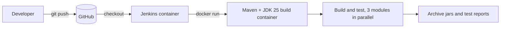

# Continuous Integration with Jenkins

This folder contains a self-contained Jenkins setup that builds and tests every module of the repository.
Jenkins runs in Docker and executes the pipeline defined in the [`Jenkinsfile`](../Jenkinsfile) at the repository root.

## Overview

| Item | Value |
|---|---|
| Jenkins image | `jenkins/jenkins:lts-jdk21` plus Docker CLI and the `docker-workflow` plugin |
| Build image | `maven:3.9-eclipse-temurin-25` (JDK 25, Maven 3.9) |
| Web UI | <http://localhost:9090> |
| Pipeline definition | `Jenkinsfile` (declarative, versioned in Git) |
| Modules built | `politest`, `party-service`, `figure-service/figure-service` |

## How it works



1. Jenkins checks out the repository from GitHub.
2. It starts a throwaway build container from the Maven/JDK 25 image, using the Docker daemon of the host
   through the mounted socket. Nothing besides Docker has to be installed for building.
3. The three modules are built and tested in parallel with `mvn -B -ntp verify`.
4. The generated jars are archived and the JUnit reports are published.
5. The build container is removed.

## Pipeline stages

| Stage | Description |
|---|---|
| Checkout SCM | Fetches the commit that triggered the build. |
| Build and test | Runs `mvn verify` for `politest`, `party-service` and `figure-service` in parallel. Includes unit tests, the architecture and modularity tests and the packaging of the Spring Boot jars. |
| Archive artifacts | Stores `**/target/*.jar` as build artifacts. |
| Post actions | Publishes the Surefire test reports (`**/target/surefire-reports/*.xml`). |

A Maven repository volume (`maven-repo`) is shared between builds, so dependencies are downloaded only once.

## Setup

### Prerequisites
- Docker (Docker Desktop on Windows or macOS) running.
- Port `9090` available on the host.

### Start Jenkins
```bash
cd jenkins
docker compose up -d --build
```

### First-time configuration
1. Read the initial admin password:
   ```bash
   docker compose exec jenkins cat /var/jenkins_home/secrets/initialAdminPassword
   ```
2. Open <http://localhost:9090>, enter the password and choose **Install suggested plugins**.
3. Create the admin user.
4. Create the job: **New Item** > **Pipeline**, then in **Pipeline** select **Pipeline script from SCM**:
   - SCM: `Git`
   - Repository URL: the URL of this repository
   - Branch specifier: `*/main`
   - Script Path: `Jenkinsfile`
5. Save and click **Build Now**.

For a private repository, add a credential of type *Username with password* (GitHub username and a personal
access token) and select it in the job configuration.

### Stop and remove
```bash
docker compose down        # stops Jenkins, keeps its data
docker compose down -v     # also deletes the Jenkins data volume
```

## Configuration reference

| File | Purpose |
|---|---|
| `jenkins/Dockerfile` | Extends the official LTS image with the Docker CLI and the Docker Pipeline plugin. |
| `jenkins/compose.yaml` | Runs Jenkins, publishes port `9090`, persists data in the `jenkins-home` volume and mounts the Docker socket. |
| `Jenkinsfile` | Declarative pipeline. Module directories are defined in the `dir(...)` steps. |

## Troubleshooting

| Symptom | Cause and fix |
|---|---|
| `Unable to find Jenkinsfile from git` | The file is missing in the branch being built. Commit and push it to the root of the repository and check the branch and Script Path in the job. |
| `docker: not found` | The Jenkins image has no Docker CLI. Rebuild it with `docker compose up -d --build`. |
| `Cannot connect to the Docker daemon` | Docker is not running on the host, or the socket is not mounted in `compose.yaml`. |
| Build fails right after checkout | Check that the module paths in the `Jenkinsfile` match the repository layout. |
| First build is slow | Docker images and Maven dependencies are being downloaded. Later builds reuse the caches. |

## Security notes

This setup targets local development and demonstration.

- The container runs as `root` and has access to the host Docker socket, which is equivalent to root access on the host.
- The build container also mounts the Docker socket, so that Testcontainers can start Kafka and MySQL for the integration tests of `stats-service`. Any code that runs in the build can therefore control the host's Docker. This is acceptable for a local, single-user setup and should be replaced by rootless or remote Docker in a shared environment.
- Do not expose this instance to the internet.
- No secrets are stored in the repository. For credentials, use the Jenkins credential store and `withCredentials`.

## Possible improvements

- Trigger builds automatically with a GitHub webhook.
- Build and publish Docker images for each service.
- Run only the pipeline of the modules that changed.
- Add static analysis and dependency vulnerability scanning.
- Deploy to a test environment after a successful build.
