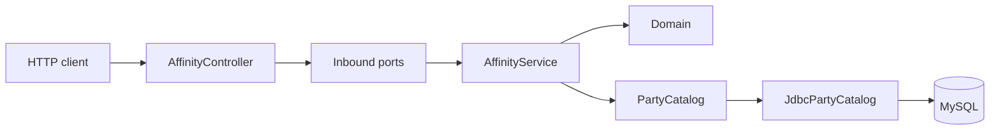

# party-service

Spring Boot microservice that stores the ideological positions of Spanish political parties and computes how close a
person is to each of them. It has its own MySQL database and exposes a REST API on port `8090`.

The positions are provisional estimates (confidence 1 to 3, with notes and sources stored in the database) and do not
represent an official assessment.

## Architecture

The service follows a hexagonal (ports and adapters) architecture. The business logic does not depend on Spring, JDBC
or HTTP; technology is plugged in from the outside through ports.

```
com.politest.party
├── domain                 Business rules, no framework dependencies
│   ├── model              Party, Position, PartyWithPositions, DatasetInfo, Axes
│   └── AffinityCalculator
├── application            Use cases
│   ├── port.in            CompareAffinityUseCase, QueryPartiesUseCase
│   ├── port.out           PartyCatalog
│   └── service            AffinityService
├── adapter
│   ├── in.web             REST controller and API models
│   └── out.persistence    JdbcPartyCatalog (MySQL through JdbcClient)
└── config                 Composition root: wires services to ports
```



Dependencies always point inwards: adapters know the application, the application knows the domain, and the domain
knows nothing about the others. `ArchitectureTests` enforces these rules with ArchUnit, so a violation breaks the build.

Because the application layer only depends on the `PartyCatalog` port, `AffinityServiceTests` runs the use cases against an
in-memory implementation, without Spring and without a database.

## How affinity is computed

For each axis, the distance between the person and the party (0 to 100) is measured. Affinity is 100 minus the weighted
mean distance. Axes missing on either side are ignored. Scale: 0 is the left pole of an axis, 100 the right pole.

## Running locally

1. Start the database: `docker compose up -d` (MySQL on port 3307, phpMyAdmin on <http://localhost:8083>).
2. Run `PartyServiceApplication`. Flyway creates the schema and loads the data.
3. Try it:
   - <http://localhost:8090/api/v1/parties>
   - <http://localhost:8090/actuator/health>
   - `POST http://localhost:8090/api/v1/affinity` with
     `{"scores":{"ECON":78,"WELFARE":71,"LIBERTY":22,"CULTURE":48,"NATION":35,"ECOLOGY":10,"DEMOCRACY":55,"CHANGE":60}}`

## API

| Method | Path | Description |
|---|---|---|
| GET | `/api/v1/parties` | All active parties with their positions and dataset information |
| GET | `/api/v1/parties/{code}` | One party, or 404 |
| POST | `/api/v1/affinity` | Affinity of the given scores (and optional weights) with every party, sorted from highest |

Invalid requests (missing scores, unknown axis, values out of range) return `400` with `{"error": "..."}`.

## Adding or correcting data

Never edit an applied migration. Add a new one in `src/main/resources/db/migration`:
`V4__add_<party>.sql` with an `INSERT` into `party` and eight rows in `party_position`, or an `UPDATE` to correct values
and, when the dataset version changes, an `UPDATE` of `dataset_info`.

## Tests

```
mvn verify
```

| Test | Purpose |
|---|---|
| `AffinityCalculatorTests` | Domain calculation |
| `AffinityServiceTests` | Use cases against an in-memory catalogue |
| `ArchitectureTests` | Hexagonal dependency rules (ArchUnit) |
| `SeedDataTests` | Consistency of the seed migrations |
