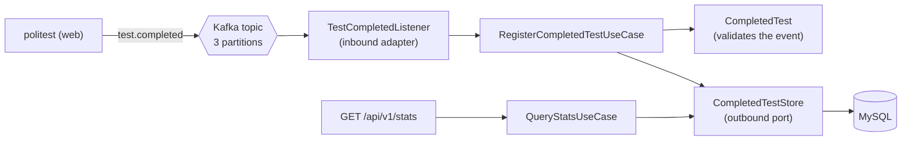

# stats-service

Microservice that turns `test.completed` events into aggregated statistics. It is the event-driven part of the [Politest](../README.md) system: it never calls the other services and nobody calls it to record data.

## How it works



1. The web application publishes one JSON event per finished test (see the contract in the [root README](../README.md#event-contract-testcompleted)).
2. `TestCompletedListener` receives it, parses the JSON and passes a command to the use case. Kafka and JSON stay in the adapter.
3. The domain validates every value (event id is a UUID, timestamp is ISO-8601, language is `es`/`ca`/`en`, axes are known, positions are 0–100). An invalid event is rejected, never stored.
4. The store inserts the test. The event id is the primary key, so a second delivery of the same event is detected and ignored.

## Idempotency

Kafka guarantees **at-least-once** delivery: after a crash or a rebalance, a record can be delivered again. The consumer therefore has to be idempotent. Here it is achieved with a primary key on `event_id`; the insert of a duplicate fails, the adapter reports it as such and the use case returns `DUPLICATE`. The test `processingTheSameEventTwiceIsIdempotent` documents the behaviour.

## Layout

```
domain/         CompletedTest, EventId, Language, AxisCode, Percentage, StatsSummary
application/    ports (RegisterCompletedTestUseCase, QueryStatsUseCase, CompletedTestStore) and StatsService
adapter/in/     messaging (Kafka listener) and web (REST controller)
adapter/out/    JDBC persistence
config/         composition root
```

The same ArchUnit rules as the other services keep the dependencies pointing inwards. Note that the Kafka listener is just another inbound adapter, next to the REST controller: the application layer does not know that messages exist.

## API

| Method | Path | Description |
|---|---|---|
| GET | `/api/v1/stats` | Total tests, tests per language and average position per axis (one decimal). |

```json
{
  "totalTests": 3,
  "testsByLanguage": { "es": 2, "ca": 1, "en": 0 },
  "averageRightPct": { "ECON": 50.0, "LIBERTY": 20.0 }
}
```

## Running locally

Start Kafka first (`../kafka`), then:

```bash
docker compose up -d      # MySQL on 3309, phpMyAdmin on 8086
mvn spring-boot:run       # http://localhost:8092
```

The consumer group is `stats-service` and starts from the earliest offset, so events published while the service was down are processed when it starts.

## Failure handling

Spring Kafka's `DefaultErrorHandler` is configured in `MessagingConfig`:

| Kind of failure | Example | What happens |
|---|---|---|
| Transient | Database briefly unavailable | Retried three times with exponential back-off (0.5 s, 1 s, 2 s) |
| Permanent | Unreadable JSON, unknown language, position above 100 | No retries: trying again would give the same result |
| Retries exhausted, or permanent | Any of the above | The record is published to the dead-letter topic `test.completed.DLT` with the error in its headers, and the consumer moves on |

A bad record therefore never blocks its partition and is never lost silently: it stays in `test.completed.DLT` to be inspected, fixed and replayed. The dead-letter topic has the same number of partitions as the source topic because the recoverer keeps the original partition.

## Tests

| Test | What it checks | Needs |
|---|---|---|
| Domain, application, listener and wiring tests | Business rules, idempotency, JSON mapping, bean resolution | Nothing |
| `ArchitectureTests` | Dependency rules between layers | Nothing |
| `StatsPipelineTests` | The real flow: Kafka to MySQL, redelivery counted once, bad records in the dead-letter topic | Docker |

`StatsPipelineTests` starts Kafka and MySQL with [Testcontainers](https://testcontainers.com/), so it exercises the real serialisation, the real error handler and the real SQL instead of mocks. Without Docker the class is skipped. In Jenkins the Docker socket is mounted in the build container so it runs there too.

## What is next

- Transactional outbox in the web application, so that an event is never lost when Kafka is unavailable.
- A replay tool or endpoint for the dead-letter topic.
